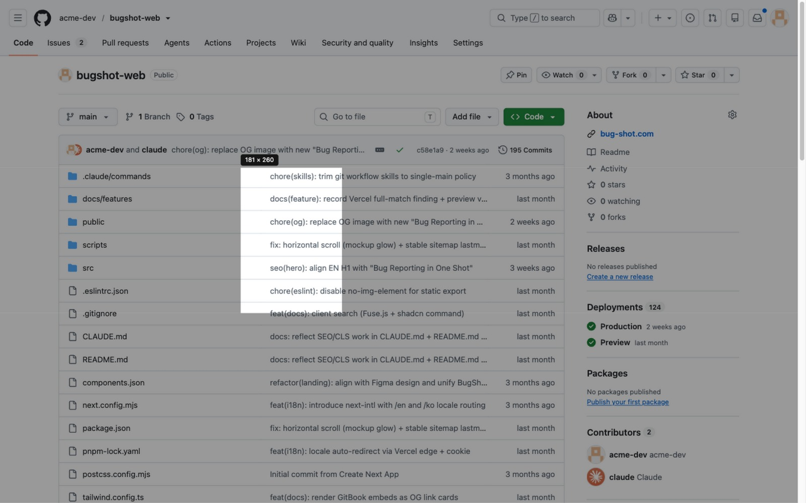
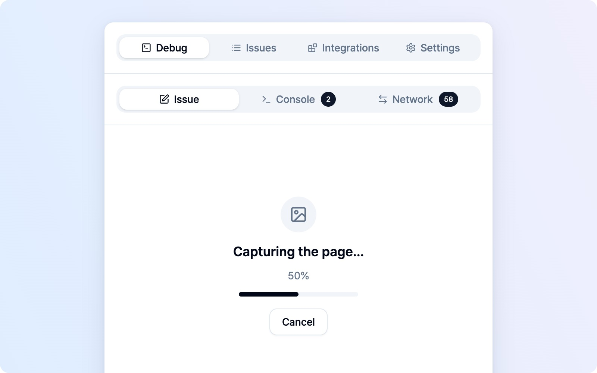
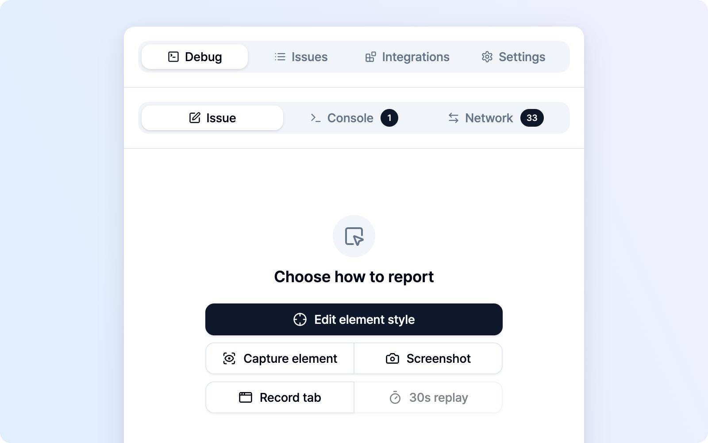

# Capture methods

There are two ways to grab an image of a bug: **Screenshot**, where you pick what part of the screen to capture, and **Capture element**, where you click a single element and it crops just that element. Capture element opens the issue draft after the first selection and lets you add more elements to the same report.

## Screenshot

In the **Debug** tab, click **Screenshot**. A crosshair appears over the page, and three capture buttons show up at the bottom of the side panel. Hover any of them to see what it does before you click.

- **Area capture** — the one that's on by default. Drag to select the region you want. You can crop just the part where the bug shows up, so the reader knows exactly where to look.
- **Screen capture** — grabs everything currently on screen, no dragging. No fiddling with the edges.
- **Page capture** — scrolls the page and stitches the whole thing, including everything below the fold, into one tall image.

## How page capture works

When you click **Page capture**, BugShot scrolls the page bit by bit, takes several shots, and stitches them into one image. You'll see the progress in the side panel, and it can take a few seconds on longer pages. Changed your mind? Just hit **Cancel** — the page scrolls back to where you were, so nothing to worry about.

A few things worth knowing:

- **Fixed and sticky headers** are kept where they first appear and hidden further down. Sticky menus are hidden only after their full content has already been captured, so nothing unseen gets dropped.
- Only vertical scrolling is stitched. Anything that overflows horizontally is captured up to the visible width.
- On endless pages (infinite scroll), BugShot stops after a certain length and lets you know that only part of the page was captured.

> Clicks and scrolling (including the mouse wheel) are blocked on the page while the capture runs — if the page moved, the stitched image would come out misaligned. Everything goes back to normal the moment it finishes.

## Capture an element

In the **Debug** tab, click **Capture element** and a crosshair appears over the page. Hover an element to highlight it, then click to crop just that element's region into a screenshot. For elements with clear edges — buttons, cards — it's faster and more precise than dragging by hand.

> **Capture element** doesn't change any styles. To pick an element and compare styles before/after, use [Inspect & Style](../element/README.md) instead.

The first capture opens the issue draft. Click the **Add element** crosshair icon on the right of the Media section, then pick one more element in the same tab. Its image appears at the bottom, with your existing title and body intact. Capturing the same element again creates a separate image, so you can show its changing states in order.

The **Environment** section lists the captured DOM selectors in selection order on the `DOM` row. Deleting an image removes only its matching value.

Use **Cancel** or **Esc** during an additional selection to return with your existing material intact. Closing and reopening the panel also restores the draft; restart any unfinished selection when you are ready. If the target tab has moved to another page, return to the original page before clicking the **Add element** crosshair icon. Elements from another tab cannot be added to this report.

> The **Add element** crosshair icon is available only for reports started with Capture element, not area, screen, or page captures. If storage is full or capture fails, the addition is refused and your existing images and report remain intact.

## Output

Area, screen and element captures give you exactly what's on screen right now (viewport-based); page capture gives you the full page, scrolling and all, as a single image. Each element selection adds a separate image. Annotate the images you need from the draft, then finish your issue.

> See [Annotation](annotation.md) for how to draw on it.
