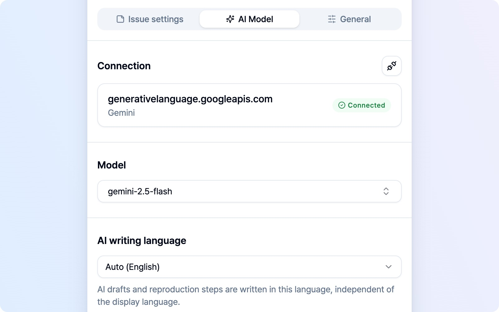
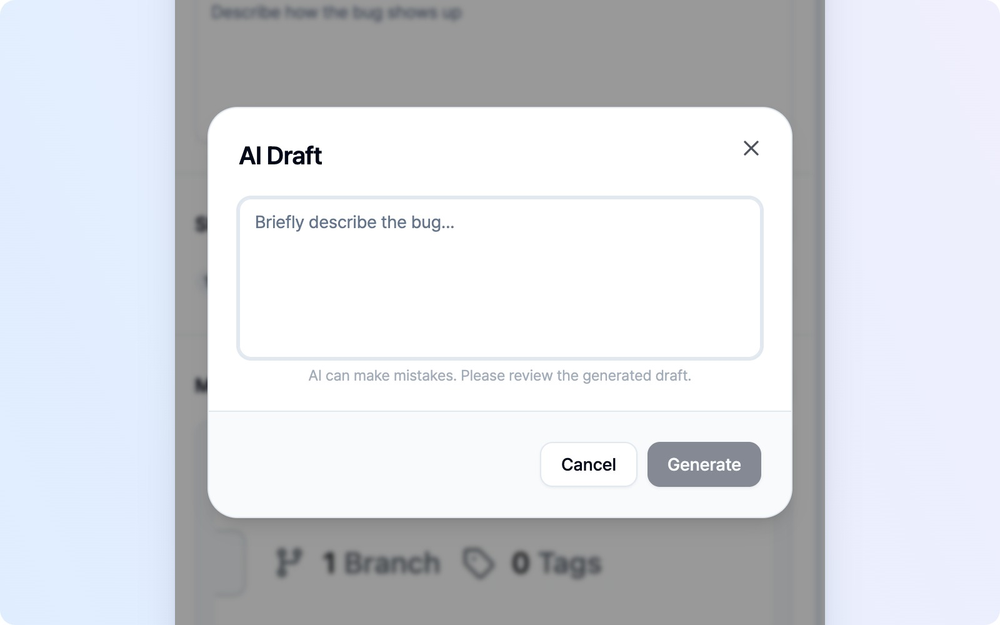

# AI LLM Connection

In the **AI Model** sub-tab of Settings, connect free AI through Gemini or OpenRouter, or use **Connect API key** for an LLM you already use. Captures, logs, and report text needed by AI go directly to your chosen service, without passing through a BugShot server.

Without a connected LLM, basic AI features still work with Chrome's built-in AI when it is available in your browser — no setup needed.

## Connect free AI

Click **Connect free AI**, choose the Gemini or OpenRouter card, and click **Next**. Read the free usage limits and data-handling notice on the card first.

| Service | Free models and limits | Data handling |
|---|---|---|
| Gemini | Flash models with image input, within Google's free limits. Pro models are excluded. | Prompts and screenshots may be used to improve Google products (except in the EEA, UK, and Switzerland). |
| OpenRouter | Free public models with image input. 50 requests per day, or 1,000 for accounts that have purchased at least $10 in credits. | Model providers may log prompts. |

### Gemini

1. Choose Gemini and click **Next** to open the Google AI Studio key page in a separate window.
2. Use **Create API key** in that window, then copy the key.
3. Paste it into BugShot's key field and click **Connect**.
4. Under **Select model**, choose a free model and click **OK**.

If you close the key page, use **Reopen key page** to open it again. **Back** returns to the cards and clears the key you entered. Cancelling just the model picker returns to the key screen so you can choose again.

### OpenRouter

1. Choose OpenRouter, click **Next**, and sign in and approve access in the window that opens. There's no key to copy manually.
2. Under **Select model**, choose a free image model and click **OK**. Wait briefly while BugShot checks whether the selected model is available.

> The approval screen shows **An app** and a **chromiumapp.org** address for this BugShot connection. If you're signing up for the first time, finish OpenRouter's onboarding, close that window, and click **Next** in BugShot again.

If the selected model is unavailable, choose another one. If there are no free image models available, connect through Gemini instead. Closing the authorization window cancels the attempt.

The short model-check request during connection may use one request from your free quota. AI Draft, AI Styling, and [Fill steps to reproduce](./issue.md) after recording also use your quota. Automatic reproduction-step filling is on by default; turn it off in **Issue settings** if you prefer.

> Cancelling or using **Disconnect** does not delete keys already issued in your OpenRouter account. Delete unwanted keys directly in OpenRouter.

After connecting through the free path, model changes also show only free models. To use other models, disconnect and reconnect with **Connect API key**.

## Connect

Already have a key? Click **Connect API key**, then choose your provider and enter the key.

- **Provider** — Choose your LLM from the list. OpenAI, Anthropic, Gemini, Mistral, Groq, Together, OpenRouter, and Ollama are built in, so there's no endpoint URL to hunt down. Not on the list? Pick **Custom** and paste any OpenAI-compatible endpoint — locally hosted models like Ollama connect the same way.
- **API Key** — The key issued by that service.

Once you connect, a screen follows for picking the model — choose the one you want under **Select model**. Most providers with an OpenAI-compatible endpoint connect without a hitch. There's no separate permission prompt — once you've filled in the details, it connects right away.

## Which AI runs

BugShot picks the AI for you, in this order — you rarely have to think about it.

1. **If you've connected an LLM**, it runs on that model. The AI banner shows the provider name (e.g. OpenAI) as a badge.
2. **If you haven't**, it falls back to Chrome's built-in AI automatically. The badge then reads **Chrome AI**, and no key or setup is needed.
3. **If Chrome's built-in AI isn't available either**, the AI features simply don't appear. In that case, just connect an LLM above.

> Chrome's built-in AI may not be offered depending on your browser version and device. For something more reliable, connecting your own LLM is the safer bet.

## Two features it turns on

Once AI is ready, two features become available.

While AI is working, editing behind the loading screen is paused. You can reach **Stop** with the keyboard, and editing becomes available again when the task finishes, is stopped, or fails.

### AI Styling

While inspecting an element, change styles with plain language like "make the button rounder" or "add more spacing." See [Styling](../element/styling.md) for the full walkthrough.

### AI Draft

Auto-fill the issue body from your capture and logs. On the issue screen, a purple **"Let AI write your draft"** banner shows up below the body sections — click **AI Draft** on the right to open the input.

Jot the bug down in a line or two (you can leave it blank in element mode) and hit **Generate**. AI fills in the title and every enabled body section in one shot. It draws not just on your capture and logs but on anything you've already typed, so feel free to run it again to polish. When a log is directly tied to the bug — not just errors, but even a normal-looking 200 response that fits what went wrong — AI also drops the **actual log into the description as a code block** — the log text is the captured original, never something the AI wrote. The evidence differs a bit per mode — see [Write an Issue (element)](../element/issue.md) for the detailed flow.

> AI slips up now and then, so give the generated result a quick look before submitting.

## AI writing language

**AI writing language** sets the language the AI writes in, separately from your display language — keep the interface in English and get the AI draft in French, if that's what your team reads. Handy when you file into a tracker your teammates read in another language.

What you set here is **the language of the prose AI writes**. The scaffolding around it — section headings like `Description`, table headers — is handled separately by [Issue body language](./issue.md). Here's the split.

| Setting | What it controls |
|---|---|
| AI writing language | The **content** AI fills into the title and body |
| Issue body language | The **scaffolding** BugShot generates — section headings, table headers |

> Want the whole issue in one language? Set **both**. Change only one and you'll end up with English headings around French prose, or the other way round.

The default is **Auto**, with the language it currently resolves to shown in parentheses (e.g. `Auto (English)`). Leave it on Auto and it follows your display language, so switching the interface later won't leave the AI stuck on the old one.

You can pick from English, 한국어, 日本語, 中文(简体), Español, Français, Deutsch, Português (Brasil), and Русский.

This applies to **AI Draft** and to [Fill steps to reproduce](./issue.md). AI Styling isn't affected — it changes style values, not prose.

> This option only shows up when you're running on an **LLM you connected** above. On Chrome's built-in AI, or a model running on your own machine (connected over a localhost address), it stays hidden and the AI follows your display language instead. If you don't see it, check which AI is running first.
