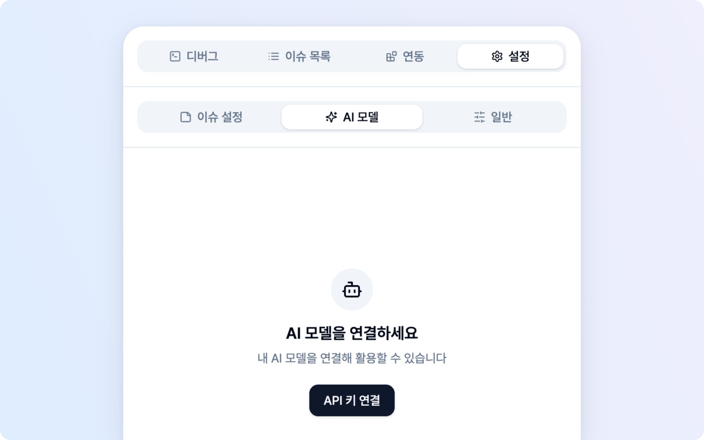
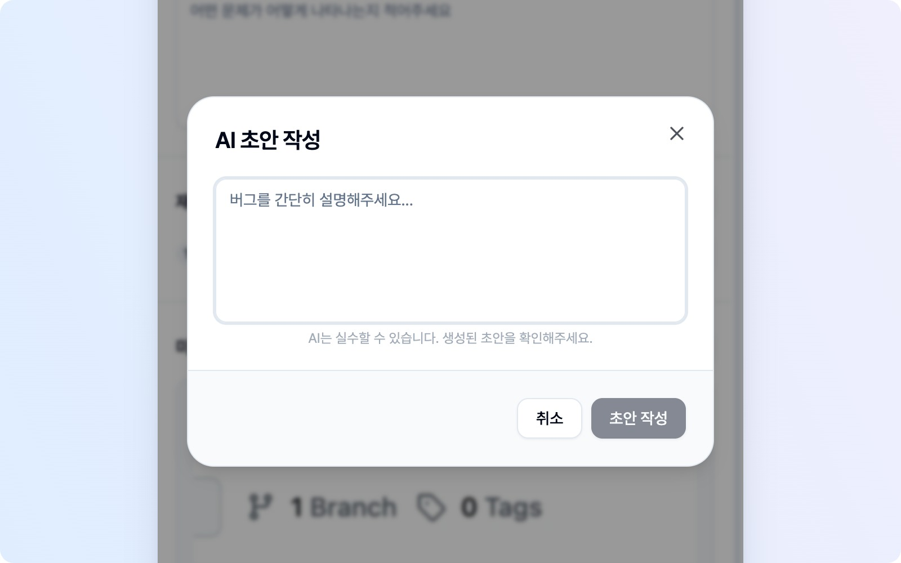

# AI LLM 연동

설정의 **AI 모델** 서브탭에서 Gemini·OpenRouter의 무료 AI를 연결하거나, **API 키 연결**로 이미 쓰시는 LLM을 연결할 수 있습니다. AI에 필요한 캡처·로그·본문은 선택한 서비스로 직접 전송되며, BugShot 서버를 거치지 않습니다.

연결한 LLM이 없어도 브라우저에 Chrome 내장 AI가 준비돼 있으면 별도 설정 없이 기본 AI 기능이 동작합니다.

## 무료로 연결하기

**무료 AI 연결**을 누르고 Gemini 또는 OpenRouter 카드를 고른 뒤 **다음**을 누릅니다. 카드에서 무료 한도와 데이터 취급 안내를 먼저 확인해 주세요.

| 서비스 | 무료로 쓸 수 있는 모델·한도 | 데이터 취급 |
|---|---|---|
| Gemini | 이미지 입력을 지원하는 Flash 모델, Google이 정한 무료 한도. Pro 모델 제외 | 프롬프트·스크린샷이 Google 제품 개선에 쓰일 수 있습니다(EEA·영국·스위스 제외). |
| OpenRouter | 이미지 입력을 지원하는 무료 공개 모델. 하루 50회, 크레딧을 $10 이상 구매한 계정은 1,000회 | 모델 제공사가 프롬프트를 기록할 수 있습니다. |

### Gemini

1. Gemini 카드에서 **다음**을 누르면 Google AI Studio 키 발급 페이지가 별도 창으로 열립니다.
2. 열린 창에서 **API 키 만들기**로 키를 만든 뒤 복사합니다.
3. BugShot의 키 입력란에 붙여넣고 **연결**을 누릅니다.
4. **모델 선택**에서 무료 모델을 고르고 **확인**을 누릅니다.

발급 창을 닫았다면 **발급 페이지 다시 열기**로 다시 열 수 있습니다. **이전**을 누르면 카드 선택으로 돌아가며 입력한 키는 지워집니다. 모델 선택만 취소하면 키 입력 화면으로 돌아가 다시 고를 수 있습니다.

### OpenRouter

1. OpenRouter 카드에서 **다음**을 누르고 열린 창에서 로그인·승인합니다. 키를 따로 복사할 필요는 없습니다.
2. **모델 선택**에서 무료 이미지 모델을 고르고 **확인**을 누릅니다. 선택한 모델을 쓸 수 있는지 확인하는 동안 잠시 기다려 주세요.

> 승인 화면에서 앱 이름이 **An app**, 주소가 **chromiumapp.org**로 표시되는 것은 BugShot 연결 흐름입니다. 처음 가입하는 경우에는 OpenRouter 안내를 마친 뒤 창을 닫고 BugShot에서 **다음**을 다시 눌러 주세요.

선택한 모델을 지금 쓸 수 없다는 안내가 나오면 다른 모델을 고릅니다. 무료 이미지 모델이 하나도 없으면 Gemini로 연결해 주세요. 인증 창을 닫으면 연결을 취소할 수 있습니다.

연결할 때 모델 확인용 짧은 요청 한 번이 무료 한도를 소모할 수 있습니다. AI 초안·스타일링뿐 아니라 녹화 후 [재현 과정 채우기](./issue.md)도 한도를 사용합니다. 재현 과정 자동 채움은 기본으로 켜져 있으며 **이슈 설정**에서 끌 수 있습니다.

> 연결을 취소하거나 **연결 해제**를 해도 이미 발급된 키는 OpenRouter 계정에 남습니다. 필요 없는 키는 OpenRouter에서 직접 삭제해 주세요.

무료 경로로 연결한 뒤에는 모델을 바꿀 때도 무료 목록만 표시됩니다. 다른 모델을 쓰려면 연결을 해제한 뒤 **API 키 연결**로 다시 연결합니다.

## 연결하기

이미 발급받은 키가 있다면 **API 키 연결**을 누르고 프로바이더와 키를 입력합니다.

- **프로바이더** — 쓰시는 LLM을 목록에서 고릅니다. OpenAI · Anthropic · Gemini · Mistral · Groq · Together · OpenRouter · Ollama가 미리 담겨 있어서(화면에는 영문 그대로 표시됩니다) 주소를 따로 찾아 넣지 않으셔도 됩니다. 목록에 없는 서비스라면 **직접 입력**을 골라 OpenAI 호환 엔드포인트 주소를 넣으시면 되고, Ollama처럼 내 컴퓨터에서 돌리는 모델도 같은 방식으로 연결됩니다.
- **API Key** — 해당 서비스에서 발급한 키.

연결하면 사용할 모델을 고르는 화면이 이어지는데, **모델 선택**에서 원하는 모델을 고르시면 됩니다. OpenAI 호환 엔드포인트를 쓰는 프로바이더라면 대부분 무리 없이 연결됩니다. 별도의 권한 허용 절차는 없으니, 입력만 마치면 바로 연결됩니다.

## 어떤 AI로 동작하나요

BugShot은 아래 순서로 알아서 AI를 고릅니다. 여러분이 신경 쓸 일은 거의 없습니다.

1. **연결한 LLM이 있으면** 그 모델로 동작합니다. AI 기능 배너에 프로바이더 이름(예: OpenAI)이 배지로 표시됩니다.
2. **연결한 LLM이 없으면** Chrome 내장 AI로 자동 폴백합니다. 이때 배지에는 **Chrome AI**가 표시되고, 별도 키나 설정은 필요 없습니다.
3. **Chrome 내장 AI도 쓸 수 없는 환경이면** AI 기능이 화면에 나타나지 않습니다. 이럴 땐 위에서 LLM을 직접 연결하시면 됩니다.

> Chrome 내장 AI는 브라우저 버전·기기 환경에 따라 제공되지 않을 수 있습니다. 더 안정적으로 쓰시려면 LLM을 직접 연결하시는 편이 좋습니다.

## 켜지는 두 기능

AI가 준비되면 두 가지 기능을 쓸 수 있습니다.

### AI 스타일링

요소를 고를 때 "버튼을 둥글게", "여백을 키워" 같은 자연어 지시로 스타일을 바꿉니다. 자세한 사용법은 [스타일링](../element/styling.md)에서 다룹니다.

### AI 초안 작성

캡처·로그를 근거로 이슈 본문을 자동으로 채웁니다. 이슈 작성 화면에서 본문 섹션 아래에 보라색 **"AI로 초안을 작성해보세요"** 배너가 나타나고, 오른쪽 **AI 초안 작성**을 누르면 입력창이 열립니다.

여기에 버그를 한 줄로 가볍게만 적고(요소 모드에서는 비워 두셔도 됩니다) **초안 작성**을 누르면, AI가 제목과 켜 둔 본문 섹션을 한 번에 채워 줍니다. 캡처·로그뿐 아니라 이미 적어 두신 제목·본문도 참고하니, 다듬고 싶을 때 다시 눌러도 됩니다. 버그와 직접 관련된 로그가 있으면 **실제 로그 원문을 발생 현상에 코드 블록으로** 함께 넣어 주는데(에러뿐 아니라 정상으로 보여도 원인일 수 있는 200 응답까지 지목합니다), 로그 내용은 AI가 쓰는 게 아니라 캡처된 원문 그대로입니다. 모드마다 근거가 조금씩 다른데, 자세한 흐름은 [이슈 작성(요소)](../element/issue.md)에서 다룹니다.

> AI도 가끔 실수합니다. 생성된 결과는 제출 전에 한 번만 확인해 주세요.

## AI 작성 언어

AI가 써 주는 글의 언어는 **AI 작성 언어**에서 따로 고르실 수 있습니다. 화면 언어와는 별개예요 — 화면은 한국어로 두고 AI 초안만 영어로 받는 식이 됩니다. 영어권 팀에 리포트를 올리거나, 팀 공용 언어가 화면 언어와 다를 때 쓰시면 편합니다.

여기서 정하는 건 **AI가 쓴 글의 언어**입니다. 이슈 본문의 뼈대(`발생 현상` 같은 섹션 제목, 표 머리글)는 [이슈 본문 언어](./issue.md)가 따로 맡고 있어요. 둘은 이렇게 나뉩니다.

| 설정 | 정하는 것 |
|---|---|
| AI 작성 언어 | AI가 채워 준 제목·본문 **내용** |
| 이슈 본문 언어 | 섹션 제목·표 머리글 등 BugShot이 만드는 **뼈대** |

> 이슈를 통째로 한 언어로 받고 싶으시면 **두 곳을 모두** 그 언어로 맞춰 주세요. 한쪽만 바꾸면 영어 본문에 한국어 섹션 제목이 섞이거나, 그 반대가 됩니다.

기본값은 **자동**이고, 괄호 안에 지금 적용될 언어가 함께 표시됩니다(예: `자동 (한국어)`). 자동으로 두시면 화면 언어를 그대로 따라가니, 나중에 화면 언어를 바꾸셔도 AI만 옛 언어로 남는 일이 없습니다.

고를 수 있는 언어는 English · 한국어 · 日本語 · 中文(简体) · Español · Français · Deutsch · Português (Brasil) · Русский입니다.

이 설정은 **AI 초안 작성**과 [재현 과정 채우기](./issue.md)의 결과물에 적용됩니다. AI 스타일링은 스타일 값을 바꾸는 기능이라 해당하지 않습니다.

> 이 항목은 위에서 **직접 연결한 LLM**으로 동작할 때만 나타납니다. Chrome 내장 AI로 동작 중이거나 내 컴퓨터에서 돌리는 모델(localhost 주소로 연결한 경우)이라면 이 항목이 보이지 않고, AI 결과물이 화면 언어를 따릅니다. 항목이 안 보인다면 먼저 어떤 AI로 동작 중인지 확인해 보세요.
